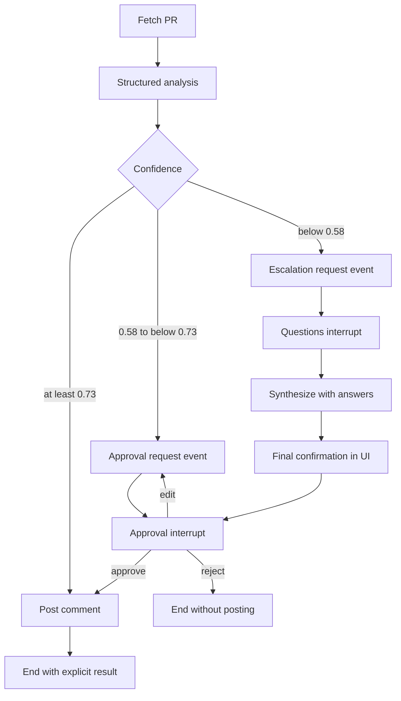

# Lab27 — HITL PR Review Agent

**Sinh viên:** Nguyễn Nhân Sâm — **MSSV:** 2A202602672  
**Tài khoản GitHub:** Nguyen-Sam-sheep-zzz  
**Ngày kiểm chứng:** 15/10/2026  
**Nhánh làm việc:** `feature/lab27-completion`

## Kết quả bàn giao

Đã hoàn thiện phần triển khai của năm bài và hồ sơ kiểm chứng cục bộ. Bộ kiểm thử cuối
đạt **31/31**; tám kịch bản fixture đạt kết quả mong đợi. GitHub fetch và structured
output của `gpt-6-luna` qua DevQuota đã được kiểm chứng bằng API thật.

Theo quyết định của người dùng ngày 15/10/2026, **không đăng bình luận GitHub**.
Hai bản review chỉ được lưu để xem trước. Kiểm chứng đăng comment thật được chủ động
loại khỏi phạm vi bàn giao; không còn bước chờ xác nhận xuất bản trong lần bàn giao này.
Mã và tài liệu nằm ở checkout hiện tại, chưa commit/push hay nộp VLearn.

| Thành phần bàn giao | Trạng thái | Nơi xem |
|---|---|---|
| Routing, HITL, escalation, audit và UI | Đã triển khai, kiểm thử cục bộ | `exercises/`, `app.py`, `tests/` |
| Kiểm thử cuối | 31/31 đạt, 16.820 giây | `evidence/verification.json`, `evidence/logs/full-tests.log` |
| Tám kịch bản nghiệp vụ | Đạt bằng fixture | `evidence/scenario_matrix.csv` |
| Tích hợp GitHub đọc PR + model thật | Đã kiểm chứng | `evidence/live_preflight.json`, `evidence/live_review_preview.json` |
| Hướng dẫn chạy và bảo vệ | Đã hoàn thiện | `docs/SETUP_WINDOWS.md`, `docs/DEMO_SCRIPT.md` |
| Đăng comment / xuất bản mã / nộp bài | Chưa thực hiện | Giữ kết quả cục bộ theo phạm vi bàn giao |

## Mục tiêu và phạm vi

Hoàn thiện cả năm bài: PR analysis có cấu trúc, routing, HITL, escalation Q&A,
audit/checkpoint SQLite và giao diện Streamlit. Các file `common/` và `audit/` provided
được giữ nguyên. Không thay threshold để ép kết quả demo.

Tên nhánh `auto_approve` trong đề có nghĩa đăng một comment review tự động;
không approve formal review, merge PR hay thay đổi mã của PR đích.

## Đối chiếu yêu cầu

| Yêu cầu | Cài đặt | Kiểm chứng |
|---|---|---|
| Bài 1: đọc diff, `PRAnalysis`, ba nhánh | `exercise_1_confidence.py`, shared prompt | Biên confidence + live PR previews |
| Bài 2: pause/resume | MemorySaver, `interrupt`, `Command(resume=...)` | Approve/reject/edit, chưa duyệt chưa post |
| Bài 3: câu hỏi cụ thể + phân tích lại | Escalation payload, Q&A validation, synthesis prompt | Diff + initial analysis + Q&A đều đi vào synthesis |
| Bài 4: audit SQL + crash recovery | `exercise_4_audit.py`, `sessions.py`, AsyncSqliteSaver | Graph/connection mới và ba subprocess pause→approve→inspect |
| Bài 5: giao diện đầy đủ | Approval/Edit, escalation form, final confirm, recent sessions, audit | Streamlit AppTest + ảnh browser fixture |
| Chất lượng bài nộp | Runtime config, lockfile, README, demo và evidence | Lệnh tái lập, provenance và giới hạn công khai |

## Thiết kế luồng

Threshold chính xác: `>=0.73` auto; `0.58 <= c < 0.73` approval; `c < 0.58`
escalation. Test dùng 0, 0.5799, 0.58, 0.72, 0.7299, 0.73 và 1; không round
trước routing. CLI bài 3/4 giữ Q&A→synthesize→commit theo đề; UI yêu cầu xác nhận cuối.

Manual edit lưu nội dung thay thế, hiển thị preview rồi interrupt lần nữa. Chỉ approve
nội dung sửa mới cho phép post; edit không được coi là reject hay tự publish.

## Audit và khả năng khôi phục

Mỗi bước quan trọng ghi `AuditEntry`: UTC timestamp, agent, action, confidence, risk,
reviewer, decision, reason, execution time. Các request event tách thành node trước
interrupt để resume thông thường không ghi pending lần nữa. Response lưu reviewer từ
`GITHUB_USER`; account GitHub live được kiểm tra khớp cấu hình này.

Checkpointer lưu state/tasks theo `thread_id`; audit lưu cột SQL phục vụ giải thích và replay.
Mỗi thao tác sở hữu connection riêng. `aget_state` phân biệt phiên mới, đang interrupt,
lỗi còn retry được và đã hoàn tất. Phiên hoàn tất được hiển thị mà không fetch/LLM/post lại.
Thread không được tái sử dụng cho PR URL khác. Query parameter `thread` cho phép mở lại
trong phiên browser mới. Custom serializer allowlist chứa hai schema provided được lưu.

SQLite được README chấp nhận và dùng cho cả hai loại dữ liệu. Các mô tả PostgreSQL
còn trong schema provided là phần tài liệu gốc; bản này không tuyên bố đã triển khai PostgreSQL.
Truy vấn recent sessions của UI dùng CASE để xếp high > med > low; tiện ích CLI provided
còn dùng MAX chuỗi nên trường worst_risk trong `--list` có giới hạn đã nêu ở hướng dẫn chạy.

## Lỗi và side effect

Post nằm ở node sau interrupt. Reject luôn thắng ngay cả khi state đã có câu trả lời escalation.
Trạng thái cuối tách rõ `committed`, `auto_committed`, `rejected`, `commit_failed`,
`auto_commit_failed`; UI chỉ báo thành công cho hai trạng thái đầu.

Lỗi provider/fetch ghi loại lỗi đã rút gọn, không ghi credential hay raw HTTP body.
Nếu synthesis lỗi sau Q&A, UI nạp checkpoint thật, bỏ form cũ và cho retry bước đang dở
bằng câu trả lời đã lưu. Timeout khi post không được retry tự động vì chưa rõ server đã nhận hay chưa.

Chưa bảo đảm exactly-once nếu process chết sau GitHub nhận POST nhưng trước checkpoint;
cần reconciliation/idempotency ở hệ thống thật. Audit/checkpoint cũng không phải một transaction
chung với GitHub. Không tuyên bố audit bất biến hay chữ ký chống sửa đổi.

## Provider và kiểm chứng live

Dùng `gpt-6-luna` tại endpoint DevQuota được cấu hình cục bộ. Structured-output smoke
và xác thực GitHub đã thành công, xem `evidence/live_preflight.json`. Adapter nằm ngoài
`common/`, ánh xạ credential trong bộ nhớ; `.env` không được đưa vào Git.

Lần live đầu cho hai PR confidence 0.96 và 0.91, đều auto dù review tìm được vấn đề.
Nguyên nhân: model nhầm mức chắc chắn về từng finding với mức đầy đủ của review toàn PR.
Đã thống nhất prompt giữa các bài: hướng dẫn confidence theo readiness/context, nêu ngữ cảnh
migration/auth thiếu cần reviewer/Q&A, không đặt điểm cố định theo URL/PR number.
Giữ nguyên kết quả trước điều chỉnh ở `evidence/live_review_before_prompt_calibration.json`.
Kết quả sau điều chỉnh nằm trong `evidence/live_review_preview.json`.

| PR | Head SHA | Confidence của lần thành công gần nhất | Nhánh |
|---|---|---|---|
| PR-Demo #1 | `164615656d47c67b0857daf02fcd412c55333d5d` | 0.79 | auto_approve, chỉ terminal bài 1 |
| PR-Demo #2 | `501f95e016f9cd241cb1a7dd60b9a27102bcb413` | 0.52 | escalate, ba câu hỏi |

Hai kết quả thành công được thu từ các lần gọi riêng, có `source` trong JSON tổng hợp.
PR #2 có hai lần `InternalServerError` trước lần thành công; giữ bằng chứng trong
`live_review_transient_failure.json`, `live_review_retry_failure.json` và `live_pr2_diagnostic.json`.
PR #1 từng cho 0.67/human_approval sau chỉnh prompt rồi 0.79/auto ở lần tiếp theo.
Vì vậy tiêu chí hai PR khác nhánh đã có bằng chứng trong mẫu thành công gần nhất, nhưng
kỳ vọng PR #1 luôn cần approval chưa ổn định. Demo phủ đủ ba nhánh được bảo đảm bằng fixture,
không bằng sửa threshold hay thay confidence thật của model.

Model tự chấm confidence chưa được calibration bằng tập dữ liệu có nhãn độc lập. Một lần demo
khác nhánh không chứng minh độ chính xác ổn định. Prompt calibration cho bài này không phải
đánh giá thống kê hay bonus confidence-calibration đã hoàn thành.

## Kiểm thử và bằng chứng

Xem `evidence/verification.json` và `evidence/logs/full-tests.log` để biết số test/lệnh/thời gian cuối.
Lần kiểm tra cuối: **31/31 test đạt trong 16.820 giây**; compileall, `git diff --check`,
lockfile sync và checksum của bảy file provided đều đạt. Rà giá trị credential cục bộ/kế thừa
trên 63 file ứng viên Git không tìm thấy giá trị trùng; đây không phải quét toàn lịch sử Git.
AppTest có cảnh báo `missing ScriptRunContext` khi chạy bare mode, không có test thất bại.
Test kiểm tra graph và state thật; network/model/post được thay ở ranh giới external dependency.
AppTest kiểm tra thao tác UI; ảnh browser bổ sung bằng chứng layout. Có regression cho lỗi
synthesis sau Q&A, ưu tiên local provider credential/endpoint và chặn compatible key khi thiếu endpoint.

`offline_demo.json` có tám case: auto, approve, reject, edit, escalate-approve,
escalate-reject, post-failure, resume. Tất cả dùng SQLite và graph thật nhưng side effect
được mô phỏng. Reject và reject xác nhận cuối có zero post attempts. Post-failure là kết quả
thất bại mong đợi, nên case kiểm thử đạt không có nghĩa comment đã đăng.

`live_review_preview.json` dùng diff/LLM thật với head SHA cụ thể, chỉ graph bài 1 không có
publishing node. Preview Markdown cho hai PR chưa được đăng; chưa có link comment thật.

## Trạng thái và giới hạn còn lại

- Đã triển khai năm bài và kiểm chứng cục bộ; kiểm chứng live GitHub fetch + LLM nằm trong evidence.
- Không đăng comment GitHub thật theo quyết định người dùng; chưa commit/push/merge/nộp VLearn.
- Các bonus time-travel, multi-reviewer, thống kê calibration và LLM auto-edit chưa triển khai.
- GITHUB_USER là metadata cấu hình, chưa phải cơ chế xác thực nhiều reviewer cho ứng dụng triển khai chung.
- Diff dài/PR lớn, retry/rate limit, tài khoản nhiều người dùng và độ bền SQLite trên nhiều máy chưa được kiểm chứng.
- UI chỉ có link PR vì helper provided không trả comment ID; không tạo URL comment giả.

Hướng dẫn chạy tại `SETUP_WINDOWS.md`; kịch bản bảo vệ tại `DEMO_SCRIPT.md`.
Điểm cuối phụ thuộc rubric/người chấm; bộ test và bằng chứng không phải cam kết điểm số.
